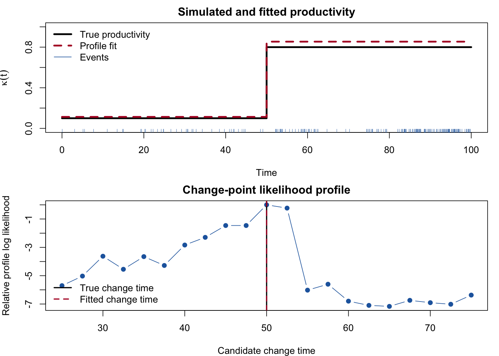
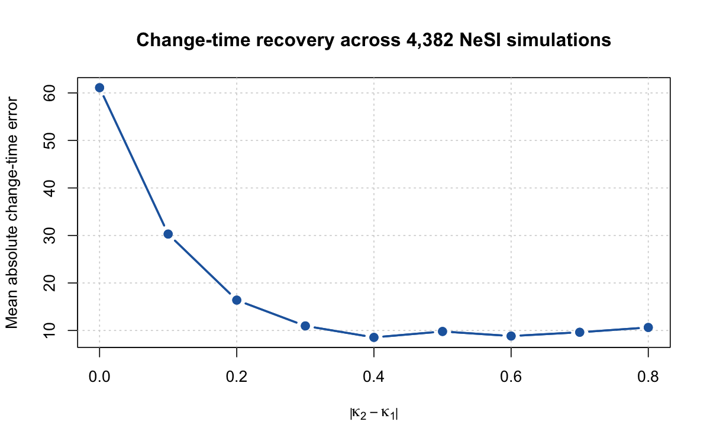

# Variable Productivity Hawkes Process Change Point Detection

R prototypes for simulation and change-point detection in spatiotemporal Hawkes processes whose productivity, or branching ratio, changes over time.



## Overview

This repository is a curated and reproducible record of my early computational research with Dr Conor Kresin at the University of Otago. I began the work in September 2024 and held a formal Assistant Research Fellow contract from November 2024 to February 2025.

The project investigated how to simulate, fit and diagnose Hawkes processes with time-varying productivity. My contribution focused on R implementation, numerical validation, change-point prototypes, a stochastic-EM algorithm and large simulation studies on NeSI. The stochastic-EM contribution is acknowledged in [Kresin, Baeumer and Phillips (2025)](https://arxiv.org/abs/2512.20068).

This is an exploratory research codebase, not an implementation of the paper's later Bayesian method. See [CONTRIBUTIONS.md](CONTRIBUTIONS.md) for detailed attribution.

## Reproducible example

The included example simulates a single productivity change, fits the segment productivities over a grid of candidate change times and plots the resulting likelihood profile. It uses synthetic data only.

```r
source("dependencies.R")
```

Then run from the repository root:

```sh
Rscript --vanilla examples/single_change_point_demo.R
```

The output is written to:

- `results/single_change_point_demo.png`
- `results/single_change_point_profile.csv`

In the demonstration, the background rate and spatial and temporal decay parameters are held at their generating values so that the figure isolates productivity and change-time recovery.

## NeSI simulation result



The summary above uses 4,382 completed runs from a 4,500-task NeSI array. It shows the main empirical result: change-time recovery improves as the difference between pre- and post-change productivity increases. The committed CSV contains only aggregated synthetic simulation results.

Recreate the figure with:

```sh
Rscript --vanilla examples/nesi_recovery_summary.R
```

## Repository map

| Path | Description |
|---|---|
| `R/VariableProductivityHawkes.R` | Simulation, finite-window likelihood, fitting and change-point routines |
| `R/SEM.R` | Cleaned stochastic-EM research prototype |
| `examples/single_change_point_demo.R` | Synthetic change-point demonstration |
| `examples/nesi_recovery_summary.R` | Aggregate NeSI result figure |
| `results/` | Reproducible figures and tabular outputs |
| `docs/methods-and-limitations.md` | Methods, findings and limitations |
| `CONTRIBUTIONS.md` | Authorship, collaboration and provenance |
| `environment/sessionInfo.txt` | R and package versions used for verification |

## Dependencies

- R
- `data.table`
- `ggplot2`
- `spatstat`

The original development used research scripts rather than a packaged interface. The functions retain that style and are supplied as a transparent computational record.

## Historical repository

The complete development history, exploratory scripts and later contributions are retained in the [original repository](https://github.com/AngusHendo/Variable-Productivity-Hawkes).
